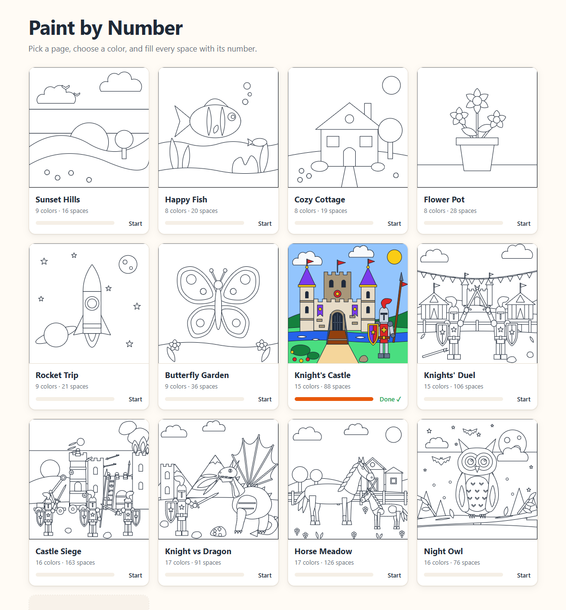
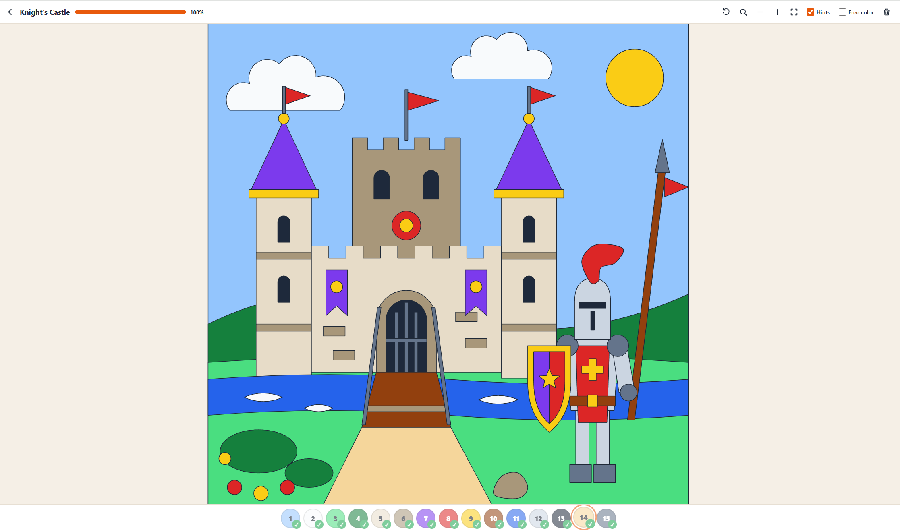

# Paint by Number

A static paint-by-number web app: pick a page, choose a color, fill every numbered space. Built with Vite + TypeScript (no framework) and deployed to GitHub Pages.

**▶ Play it here: https://nreff.github.io/paint-by-number/**

Pick a picture from the gallery, choose a color from the palette, and fill in every space marked with that number. There are 12 pages, from simple ones like a sunset or a fish to detailed ones like castle sieges, a dragon fight, horses and a night owl. Hints stripe the spaces that match the selected color. A Free color mode lets you paint anything any color. Progress saves in your browser, and the app works with a mouse or with touch (pinch to zoom on phones).

<p align="center">
  
  &nbsp;
  
</p>

## Run locally

```bash
npm install
npm run dev            # http://localhost:5173
npm run dev -- --host  # also reachable from your phone on the same Wi-Fi
npm run build          # typecheck + production build into dist/
```

## Controls

| | Computer | Phone / tablet |
|---|---|---|
| Fill | Click a space | Tap a space (only fills if it matches the selected color; other taps are ignored) |
| Zoom | Mouse wheel, `+` / `-`, `0` to fit | Pinch with two fingers |
| Pan | Drag | Drag with one finger |
| Pick color | Click a swatch or press `1`–`9` | Tap a swatch |
| Undo | `Ctrl/Cmd+Z` | Undo button |
| Find next space | `F` or the magnifier button | Magnifier button |
| Hints (stripes on matching spaces) | `H` or the Hints toggle | Hints toggle |

"Free color" lets you paint any space with any color. Progress is saved in the browser (localStorage).

## Deploy to GitHub Pages

1. Create a GitHub repo (e.g. `paint-by-number`) and push this project to its `main` branch.
2. In the repo go to **Settings → Pages** and set **Source** to **GitHub Actions**.
3. Every push to `main` runs `.github/workflows/deploy.yml`, which builds and publishes `dist/`.
   The site appears at `https://<user>.github.io/<repo>/`.

It works from any sub-path because `vite.config.ts` uses `base: './'` and the app uses hash routes (`#/page/fish`), so deep links and reloads never 404.

## Project layout

```
src/
  pages/         Coloring page data (ColoringPage objects) + shape helpers
  core/session.ts  Renderer-agnostic coloring state: fills, rules, undo, progress
  regionmap.ts   Rasterizes a page to find label spots and hit-test taps
  colorer.ts     Coloring screen (SVG view over the session)
  zoom.ts        Wheel / pinch zoom and drag pan
  gallery.ts     Page picker
```

### Adding a page

Create `src/pages/<name>.ts` exporting a `ColoringPage` (see `src/pages/types.ts`) and add it to `src/pages/index.ts`. Regions are SVG paths drawn in order (later ones sit on top). You never place numbers by hand: label positions are computed automatically.

## Roadmap

- **Your own photos:** convert an uploaded image into a `ColoringPage` (palette + region paths), probably with an image model. Because labels and hit-testing work from the page data alone, generated pages need no special handling.
- **3D coloring (Three.js):** project a page onto a 3D surface (raycast → UV → same region lookup), or a small paintable 3D world where each object is a numbered region. `core/session.ts` has no SVG code so a 3D view can drive the same session.
